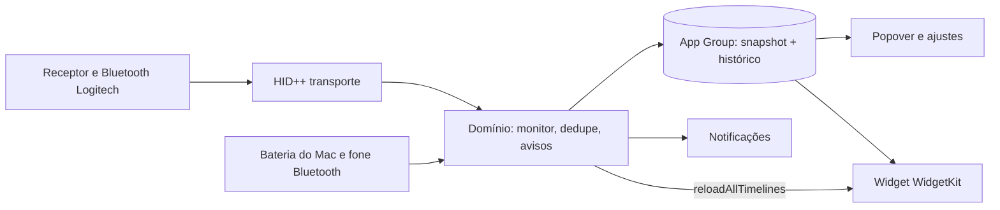

# Arquitetura — LogiBattery

Visão das partes do sistema e de como se conectam. Cada parte aqui ganha uma linha em [TESTING.md](TESTING.md). Decisões difíceis de reverter viram ADR em [adr/](adr/).
Parte com UI tem suas telas em [../design/telas.md](../design/telas.md).

Status: aprovada em 2026-10-27

## 1. Contexto
- O que o sistema faz: lê a bateria de mouse e teclado Logitech (receptor e Bluetooth) por HID++ e mostra em widget, popover na barra de menu, avisos e histórico. Ver [PRD.md](PRD.md).
- Quem usa e quem integra: uma pessoa, no próprio Mac. Integra com `IOHIDManager`, Bluetooth do macOS, Central de Notificações e WidgetKit. Sem rede, sem servidor.
- Restrições: macOS 14+; WidgetKit não acessa IOKit/HID; Input Monitoring (TCC) exigido para ler HID; sandbox e entitlements precisam valer na distribuição futura; zero telemetria.

## 2. Partes do sistema

Inventário. `-` quando a parte não existe.

| Parte | Responsabilidade | Tecnologia | Dono / pasta | Depende de | Dado sensível? |
|---|---|---|---|---|---|
| Interface: popover e ajustes | Lista de aparelhos, gráfico, ajustes, guia de permissão | SwiftUI, Swift Charts | `LogiBattery/UI` | Domínio, Persistência | Não |
| Interface: widget | Desenhar o snapshot nos três tamanhos | WidgetKit | `LogiBatteryWidget` | Snapshot (App Group) | Não |
| Site público | Landing com download, prints e apoio por Pix; pt-BR, en, es; claro e escuro | HTML, CSS e JS estáticos, GitHub Pages (`deploy-site.yml`) | `site/`, design system em DESIGN.md §9 | Release do GitHub (link de download) | Não (a chave Pix é pública, de doação) |
| API / backend | - | - | - | - | - |
| Domínio | Modelo de aparelho, deduplicação, regras de aviso, política de leitura | Swift puro | `LogiBattery/Core/Domain` | HIDPP (via protocolo) | Não |
| HID++ (transporte e protocolo) | Enumerar receptores e Bluetooth, falar HID++ 1.0/2.0, ler bateria e carga | `IOHIDManager`, Swift | `LogiBattery/Core/HIDPP` | Sistema (IOKit) | Número de série do aparelho |
| Bateria do sistema | Ler a bateria interna do Mac e a de fone Bluetooth conectado (US-13) | `IOPowerSources`, `IOBluetooth` (chaves KVC privadas) | `LogiBattery/Core/System/SystemBatteries.swift` | Sistema | Não |
| Persistência | Snapshot JSON e histórico de leituras no App Group | JSON + SwiftData (ou SQLite) | `LogiBattery/Core/Storage` | App Group | Não |
| Autenticação e permissões | Estado de Input Monitoring e Bluetooth, guia ao painel de Privacidade | TCC, `IOHIDCheckAccess` | `LogiBattery/Core/Permissions` | Sistema | Não |
| Integrações externas | Notificações e login item | `UserNotifications`, `SMAppService` | `LogiBattery/Core/System` | Sistema | Não |
| Jobs, agendamentos | Polling (1 min por padrão) e reação a eventos HID++ de bateria | `Task`, timers | `LogiBattery/Core/Domain` | HID++, Persistência | Não |
| CLI / automações | - | - | - | - | - |
| Dados / ETL / ML | - | - | - | - | - |
| Infra, deploy | Build, assinatura, notarização futura, CI | XcodeGen, GitHub Actions | `project.yml`, `.github` | - | Não |

## 3. Diagrama

Só o app host acessa o hardware. O widget lê o snapshot e nunca fala com HID.

## 4. Fluxos principais
- Leitura (US-01, US-02, US-03, US-04): o monitor enumera dispositivos HID com vendor `0x046D`; para cada receptor, pergunta aos índices 1 a 6 quem está pareado; resolve a feature de bateria `0x1004` (Unified Battery; `0x1000` e `0x1001` não estão implementadas porque nenhum aparelho do Lucas as usa, e aparelho sem `0x1004` não aparece; HID++ 1.0 fora do MVP); deduplica por nome (série quando houver aparelho repetido; ver `DeviceDeduplicator`); grava snapshot e ponto de histórico.
- Widget (US-05): o host grava o snapshot a cada leitura (`generatedAt` é o sinal de que está vivo) e só chama `WidgetCenter.shared.reloadAllTimelines()` quando muda o que o widget mostra (`Snapshot.meaningfullyDiffers`: aparelho, %, estado, caminho ou leitura velha) ou quando o snapshot anterior já estava desatualizado; recarregar a cada leitura esgota o orçamento do WidgetKit. O widget lê o JSON e devolve uma entrada por minuto durante 15 min, então o "há X min" e o cinza andam sem reload. Nos tamanhos médio (4 anéis por página) e grande (6 linhas por página a partir do 7º aparelho, sem gráfico a partir do 5º), o widget pagina via `NextWidgetPageIntent` (`AppIntent`), guardando a página atual em `widget-pages.json` no App Group (`WidgetPageStore`, #79). Histórico e snapshot são gravados em separado: erro em um não impede o outro, e vai para o `Logger` (`com.lucasstop.LogiBattery`, categoria `storage`) sem nome nem série. O host lê no intervalo dos ajustes (padrão 1 min) mesmo sem o popover aberto, e relê em até ~2 s quando um aparelho conecta ou desconecta ou manda um frame HID++ espontâneo (`HIDDiscovery.changes`). Depois dessa releitura, repete a leitura 5, 10 e 15 s depois: aparelho recém-conectado (ex.: mouse trocando para Bluetooth) ainda está acordando e falha a primeira leitura, e esperar o próximo ciclo de 1 min deixaria o widget sem ele. A lista de interfaces sai do IORegistry a cada leitura (`HIDDiscovery.endpoints()`); um `IOHIDManager` fora de run loop congela a lista na abertura e não via aparelho que conectou depois.
- Aviso (US-07, US-08): a regra de aviso compara a leitura nova com o último estado notificado por aparelho; dispara uma vez e rearma quando a bateria sobe acima do limite ou um novo ciclo de carga começa.
- Bateria do sistema (US-13): a cada leitura, o host soma aos aparelhos HID++ a bateria interna do Mac (`IOPowerSources`, só `InternalBattery`) e os fones Bluetooth conectados de classe áudio (`IOBluetoothDevice`, chaves `batteryPercent*`; fone de dois lados sem nível único usa o lado mais fraco). Fone fora da leitura foi desligado e some na hora, sem a regra das 24 h; o Mac vem primeiro na ordem do widget e do popover. O Mac entra nos avisos e no ícone da barra como qualquer aparelho.
- Bateria BLE de qualquer marca (US-15, [ADR 0003](adr/0003-bateria-de-ble-pelo-battery-service-padrao.md)): `BLEBatteryReader` (`LogiBattery/Core/System/BLEBatteryService.swift`) lê o Battery Service padrão (GATT `0x180F`/`0x2A19`) dos periféricos conectados por `CoreBluetooth`, numa fila própria com timeout de 4 s, e `SystemBatteries.read` soma o resultado como `bt-ble-<nome>`. O `DeviceDeduplicator` mantém a leitura HID++ do mesmo aparelho (ex.: MX Master 3S) e descarta a genérica.
- Permissão (US-12): sem Input Monitoring a enumeração retorna vazio; o app mostra o guia em vez de lista vazia.

## 5. Dados
- Entidades principais e relações: ver [DATA.md](DATA.md) (`Device`, `Reading`, `Settings`, `Snapshot`).
- Retenção, backup e migração: histórico de 90 dias por padrão; sem backup próprio; migração de schema reversível quando o histórico passar a SwiftData.

## 6. Segurança e privacidade
- Autenticação / autorização: não há conta. Permissões do sistema: Input Monitoring e Bluetooth.
- Segredos: variáveis de ambiente, nunca no repositório. Lista em `.env.example`.
- Dados pessoais e LGPD: nenhum dado pessoal coletado; o número de série do aparelho não sai do Mac. O nome do Mac e o do fone podem conter o nome do usuário: ficam só no App Group, nunca em log. Sem rede, sem telemetria, sem log com série em claro.

## 7. Ambientes e deploy
- Ambientes: local e CI. Sem preview, sem produção hospedada.
- Portas locais: não se aplica (app nativo, sem servidor).
- Deploy: app em `~/Applications/LogiBattery.app` com assinatura local; distribuição futura com Developer ID e notarização; rollback: reinstalar a versão anterior.

## 8. Qualidade e operação
- Estratégia de testes: [TESTING.md](TESTING.md).
- Observabilidade: `os.Logger` com subsistema `LogiBattery`, sem série nem nome do usuário; exportar log de diagnóstico por ação explícita (futuro).
- Requisitos não funcionais com meta: leitura completa em menos de 2 s por aparelho; app ocioso abaixo de 1% de CPU; widget e popover acessíveis (VoiceOver, contraste, Dynamic Type).

## 9. Riscos e dívida conhecida
- HID++ não é documentado oficialmente: protocolo vem de engenharia reversa (Solaar, libratbag). Mitigação: parser isolado, testado com frames gravados.
- Aparelho dormindo não responde (o PRO X TKL por Lightspeed dorme ~12 s depois da última tecla e a leitura dá erro): o `DeviceListViewModel` mantém a última leitura de quem não veio no scan pelo tempo `ReadingPolicy.keepFor` (padrão 24 h), com a hora; passado `ReadingPolicy.grayAfter` (padrão 30 min) ela fica cinza. Os dois valores e o escopo do Esquecer (`ReadingPolicy.forgetScope`: só cinza ou também verde) vêm dos Ajustes (#115), não são mais constantes. `SettingsModel.onChange` emite um `SettingsAdjustment`; `DeviceListViewModel.apply(_:)` troca a política e refiltra a lista sem escanear, e o host republica o snapshot com `policy`, que o widget usa nas mesmas funções. "Sumir = Na hora" faz o restore no launch não mostrar nada até o primeiro scan (consequência aceita). A regra de leitura mantida mora num lugar só, `ReadingPolicy` e `Device.isKept`/`isGray` (`Device.swift`, compilado também no widget): popover, widget, ordem da lista, restore no launch e `canForget` chamam as mesmas funções (#116; antes cada um tinha a sua constante e um fix corrigia só um deles). O relógio é injetado no view model (`now:`), o que deixa os testes passarem 24 h (`DeviceLifecycleScenarioTests`). Cinza vale só para leitura mantida: quem respondeu ao último scan nunca fica cinza, mesmo com intervalo de leitura de 60 min. "App parado" (`Snapshot.isStale`) é outra coisa: nenhum snapshot novo em `max(30 min, 2 × intervalo)`, com o intervalo no snapshot (`intervalMinutes`). O restore no launch aplica a mesma janela de `keepFor`; snapshot de app que estava parado só devolve leitura de receptor, porque o estado do Bluetooth e do fone mudou sem ninguém ver. Leitura mantida (que não respondeu ao último scan) vai para o fim da lista, abaixo de quem respondeu (`Snapshot.widgetOrder`, #100); aparelho Bluetooth fora do scan some na hora, como o fone. Pelo receptor, dormindo e desligado não se distinguem (o link cai nos dois). Leitura mantida e cinza pode ser esquecida pelo menu de contexto da linha (`forget`, #113): sai da lista e do snapshot, o histórico fica, o aviso Desfazer (`undoForget`) dura 8 s e o aparelho volta sozinho se responder a um scan. O histórico grava o ponto no instante da leitura (`readAt`) e não regrava leitura mantida. Só frame do próprio aparelho dispara releitura (`IOHIDTransport.isDeviceEvent`: notificação HID++ 1.0 ou evento com software id 0); resposta a pedido do Logi Options+ não conta.
- Input Monitoring e sandbox diferem entre assinatura local e distribuída: validar na issue de distribuição.
- Aparelho com `0x1000` ou `0x1001` (sem `0x1004`) é lido desde a #89; a `0x1001` (voltagem) usa curva linear LiPo genérica, sem tabela por modelo. Modelo que fuja da curva pede fixture própria.
- As chaves `batteryPercent*` do `IOBluetoothDevice` são privadas: uma versão do macOS pode tirá-las, e o fone só some da lista (ADR 0002).
- Receptor e Bluetooth do mesmo aparelho podem divergir um instante: regra de dedupe prioriza a leitura mais recente. A leitura HID++ vence a genérica do sistema (`bt-*`) sempre, sem janela de tempo: o `merge` só junta leituras do mesmo scan e o sistema é carimbado depois dos endpoints, que levam 1 s por índice sem resposta (#116).
- Transporte HID++ (#116): resposta HID++ 2.0 de erro (`11 índice FF feature função|sw erro`) encerra o pedido na hora, em vez de esperar o timeout de 1 s; cada pedido sai com software id rotativo (1 a 15; o 0 é dos eventos), então a resposta atrasada de um pedido não casa com o seguinte (a busca de `0x1004` e a de `0x1000` no Root têm o mesmo cabeçalho); report `0x11` com menos de 20 bytes é descartado. A espera do processo filho que lê o nível do fone (#107) sai da main thread.
- Conhecido e sem correção: `IOHIDTransport.deinit` libera o buffer logo depois do `IOHIDDeviceCancel`, sem cancel handler (um report já na fila pode tocar memória liberada ao desplugar o receptor; só reproduz com IOKit real, smoke manual "desplugar o receptor durante o scan"). Aparelho mantido e aparelho novo pareado no mesmo índice do receptor têm o mesmo id, e `forget` remove os dois. Teclado Lightspeed que acorda a cada tecla manda `0x41` e dispara ~4 scans a cada ~37 s enquanto se digita (medir antes de mexer; meta de CPU ociosa < 1%). Aparelho Bluetooth HID++ que perde um scan some naquele ciclo e volta no seguinte (pisca). A identidade do aparelho é o nome: dois aparelhos com o mesmo nome viram um. Fone sem nível que reaproveita a última leitura nunca expira, porque a leitura reaproveitada entra como "veio no scan".

## 10. Decisões (ADR)

| ADR | Decisão | Status |
|---|---|---|
| [0001](adr/0001-host-le-hardware-widget-le-snapshot.md) | App host lê o hardware e publica snapshot por App Group; o widget só lê | aceita |
| [0002](adr/0002-bateria-do-sistema-via-iopowersources-e-iobluetooth.md) | Bateria do Mac por `IOPowerSources` e do fone por chaves privadas do `IOBluetoothDevice` | aceita |
| [0003](adr/0003-bateria-de-ble-pelo-battery-service-padrao.md) | Bateria de teclado e mouse BLE de qualquer marca pelo Battery Service padrão (`CoreBluetooth`) | aceita |

## 11. Spike HID++ (issue #10, 2026-10-29)

Executável descartável em [`tools/hidpp-spike/`](../tools/hidpp-spike/main.swift) (`swiftc -O main.swift`; `HIDPP_TRACE=1` imprime os frames). Frames reais, sem série, em `Tests/Fixtures/hidpp/`.

| Aparelho | Caminho | Receptor (PID) | Índice | HID++ | Feature de bateria | Leitura |
|---|---|---|---|---|---|---|
| MX Master 3S | Bolt | `0xC548` | 2 | 4.5 | `0x1004` no índice 8 | 90%, nível `0x08`, status 0 |
| PRO X TKL | Lightspeed | `0xC547` | 1 | 4.2 | `0x1004` no índice 7 | 79%, nível `0x08`, status 0 |

Achados que viram regra do parser:
- A interface HID++ do receptor é `usagePage 0xFF00`, usage `0x01`; a leitura funcionou a partir do terminal, que pode já ter Input Monitoring; validar a permissão no app assinado.
- Long report `0x11`, 20 bytes: `11 índice feature função|sw params`. Pedido de feature: `11 idx 00 01 <id hi> <id lo>`; bateria `0x1004` função 1: `11 idx <feature> 11`. Resposta: `[4]` = porcentagem, `[5]` = nível (1 crítico, 2 baixo, 4 bom, 8 cheio), `[6]` = status de carga.
- Índice sem aparelho responde HID++ 1.0 `10 idx 8f ...` (erro): o parser descarta `0x8f` e `0xff` em `[2]`.
- Respostas chegam fora de ordem e misturadas com eventos: casar resposta por índice, feature e função+sw, nunca pegar "o próximo frame".
- Feature de bateria nos dois aparelhos é `0x1004`; `0x1000` e `0x1001` não foram observadas e não foram implementadas.
- Bluetooth (US-02, 2026-10-29): os aparelhos aparecem no `IOHIDManager` com transporte `Bluetooth Low Energy` (MX Master 3S `0xB034`, PRO X TKL `0xB382`), só com as interfaces genéricas de mouse e teclado, sem página `0xFF43`. Mesmo assim respondem ao long report `0x11` com índice `0xFF`, com os mesmos frames e a mesma feature `0x1004` do receptor (fixtures `bluetooth-*.txt`). Receptor ou Bluetooth do mesmo aparelho aparecem hoje como dois itens; a deduplicação é a US-03 (#14).
