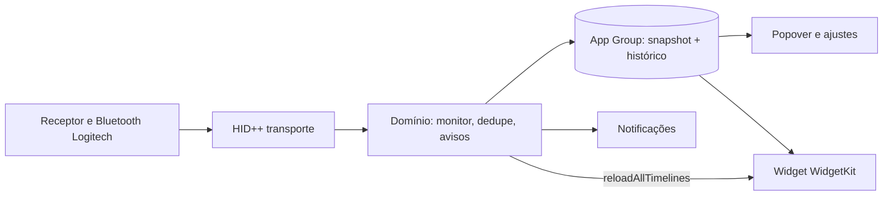

# Arquitetura — LogiBattery

Visão das partes do sistema e de como se conectam. Cada parte aqui ganha uma linha em [TESTING.md](TESTING.md). Decisões difíceis de reverter viram ADR em [adr/](adr/).
Parte com UI tem suas telas em [../design/telas.md](../design/telas.md).

Status: aprovada em 2026-10-27

## 1. Contexto
- O que o sistema faz: lê a bateria de mouse e teclado Logitech (receptor e Bluetooth) por HID++ e mostra em widget, popover na barra de menu, avisos e histórico. Ver [PRD.md](PRD.md).
- Quem usa e quem integra: uma pessoa, no próprio Mac. Integra com `IOHIDManager`, Bluetooth do macOS, Central de Notificações e WidgetKit. Sem rede, sem servidor.
- Restrições: macOS 14+; WidgetKit não acessa IOKit/HID; Input Monitoring (TCC) exigido para ler HID; sandbox e entitlements precisam valer na distribuição futura; zero telemetria.

## 2. Partes do sistema

Inventário. `-` quando a parte não existe.

| Parte | Responsabilidade | Tecnologia | Dono / pasta | Depende de | Dado sensível? |
|---|---|---|---|---|---|
| Interface: popover e ajustes | Lista de aparelhos, gráfico, ajustes, guia de permissão | SwiftUI, Swift Charts | `LogiBattery/UI` | Domínio, Persistência | Não |
| Interface: widget | Desenhar o snapshot nos três tamanhos | WidgetKit | `LogiBatteryWidget` | Snapshot (App Group) | Não |
| API / backend | - | - | - | - | - |
| Domínio | Modelo de aparelho, deduplicação, regras de aviso, política de leitura | Swift puro | `LogiBattery/Core/Domain` | HIDPP (via protocolo) | Não |
| HID++ (transporte e protocolo) | Enumerar receptores e Bluetooth, falar HID++ 1.0/2.0, ler bateria e carga | `IOHIDManager`, Swift | `LogiBattery/Core/HIDPP` | Sistema (IOKit) | Número de série do aparelho |
| Persistência | Snapshot JSON e histórico de leituras no App Group | JSON + SwiftData (ou SQLite) | `LogiBattery/Core/Storage` | App Group | Não |
| Autenticação e permissões | Estado de Input Monitoring e Bluetooth, guia ao painel de Privacidade | TCC, `IOHIDCheckAccess` | `LogiBattery/Core/Permissions` | Sistema | Não |
| Integrações externas | Notificações e login item | `UserNotifications`, `SMAppService` | `LogiBattery/Core/System` | Sistema | Não |
| Jobs, agendamentos | Polling (5 min) e reação a eventos HID++ de bateria | `Task`, timers | `LogiBattery/Core/Domain` | HID++, Persistência | Não |
| CLI / automações | - | - | - | - | - |
| Dados / ETL / ML | - | - | - | - | - |
| Infra, deploy | Build, assinatura, notarização futura, CI | XcodeGen, GitHub Actions | `project.yml`, `.github` | - | Não |

## 3. Diagrama

Só o app host acessa o hardware. O widget lê o snapshot e nunca fala com HID.

## 4. Fluxos principais
- Leitura (US-01, US-02, US-03, US-04): o monitor enumera dispositivos HID com vendor `0x046D`; para cada receptor, pergunta aos índices 1 a 6 quem está pareado; resolve a feature de bateria (`0x1004`, depois `0x1000`, `0x1001`; HID++ 1.0 fora do MVP); deduplica por nome (série quando houver aparelho repetido; ver `DeviceDeduplicator`); grava snapshot e ponto de histórico.
- Widget (US-05): após gravar o snapshot, o host chama `WidgetCenter.shared.reloadAllTimelines()`; o widget lê o JSON e desenha.
- Aviso (US-07, US-08): a regra de aviso compara a leitura nova com o último estado notificado por aparelho; dispara uma vez e rearma quando a bateria sobe acima do limite ou um novo ciclo de carga começa.
- Permissão (US-12): sem Input Monitoring a enumeração retorna vazio; o app mostra o guia em vez de lista vazia.

## 5. Dados
- Entidades principais e relações: ver [DATA.md](DATA.md) (`Device`, `Reading`, `Settings`, `Snapshot`).
- Retenção, backup e migração: histórico de 90 dias por padrão; sem backup próprio; migração de schema reversível quando o histórico passar a SwiftData.

## 6. Segurança e privacidade
- Autenticação / autorização: não há conta. Permissões do sistema: Input Monitoring e Bluetooth.
- Segredos: variáveis de ambiente, nunca no repositório. Lista em `.env.example`.
- Dados pessoais e LGPD: nenhum dado pessoal; o número de série do aparelho não sai do Mac. Sem rede, sem telemetria, sem log com série em claro.

## 7. Ambientes e deploy
- Ambientes: local e CI. Sem preview, sem produção hospedada.
- Portas locais: não se aplica (app nativo, sem servidor).
- Deploy: app em `~/Applications/LogiBattery.app` com assinatura local; distribuição futura com Developer ID e notarização; rollback: reinstalar a versão anterior.

## 8. Qualidade e operação
- Estratégia de testes: [TESTING.md](TESTING.md).
- Observabilidade: `os.Logger` com subsistema `LogiBattery`, sem série nem nome do usuário; exportar log de diagnóstico por ação explícita (futuro).
- Requisitos não funcionais com meta: leitura completa em menos de 2 s por aparelho; app ocioso abaixo de 1% de CPU; widget e popover acessíveis (VoiceOver, contraste, Dynamic Type).

## 9. Riscos e dívida conhecida
- HID++ não é documentado oficialmente: protocolo vem de engenharia reversa (Solaar, libratbag). Mitigação: parser isolado, testado com frames gravados, fallback de feature.
- Aparelho dormindo não responde: tratar como "sem leitura" e mostrar a última conhecida com a hora.
- Input Monitoring e sandbox diferem entre assinatura local e distribuída: validar na issue de distribuição.
- Voltagem para porcentagem varia por modelo (feature `0x1001`): tabela por aparelho, com curva genérica de fallback.
- Receptor e Bluetooth do mesmo aparelho podem divergir um instante: regra de dedupe prioriza a leitura mais recente.

## 10. Decisões (ADR)

| ADR | Decisão | Status |
|---|---|---|
| [0001](adr/0001-host-le-hardware-widget-le-snapshot.md) | App host lê o hardware e publica snapshot por App Group; o widget só lê | proposta |

## 11. Spike HID++ (issue #10, 2026-10-29)

Executável descartável em [`tools/hidpp-spike/`](../tools/hidpp-spike/main.swift) (`swiftc -O main.swift`; `HIDPP_TRACE=1` imprime os frames). Frames reais, sem série, em `Tests/Fixtures/hidpp/`.

| Aparelho | Caminho | Receptor (PID) | Índice | HID++ | Feature de bateria | Leitura |
|---|---|---|---|---|---|---|
| MX Master 3S | Bolt | `0xC548` | 2 | 4.5 | `0x1004` no índice 8 | 90%, nível `0x08`, status 0 |
| PRO X TKL | Lightspeed | `0xC547` | 1 | 4.2 | `0x1004` no índice 7 | 79%, nível `0x08`, status 0 |

Achados que viram regra do parser:
- A interface HID++ do receptor é `usagePage 0xFF00`, usage `0x01`; a leitura funcionou a partir do terminal, que pode já ter Input Monitoring; validar a permissão no app assinado.
- Long report `0x11`, 20 bytes: `11 índice feature função|sw params`. Pedido de feature: `11 idx 00 01 <id hi> <id lo>`; bateria `0x1004` função 1: `11 idx <feature> 11`. Resposta: `[4]` = porcentagem, `[5]` = nível (1 crítico, 2 baixo, 4 bom, 8 cheio), `[6]` = status de carga.
- Índice sem aparelho responde HID++ 1.0 `10 idx 8f ...` (erro): o parser descarta `0x8f` e `0xff` em `[2]`.
- Respostas chegam fora de ordem e misturadas com eventos: casar resposta por índice, feature e função+sw, nunca pegar "o próximo frame".
- Feature de bateria nos dois aparelhos é `0x1004`; `0x1000` e `0x1001` ficam como fallback (não observados).
- Bluetooth (US-02, 2026-10-29): os aparelhos aparecem no `IOHIDManager` com transporte `Bluetooth Low Energy` (MX Master 3S `0xB034`, PRO X TKL `0xB382`), só com as interfaces genéricas de mouse e teclado, sem página `0xFF43`. Mesmo assim respondem ao long report `0x11` com índice `0xFF`, com os mesmos frames e a mesma feature `0x1004` do receptor (fixtures `bluetooth-*.txt`). Receptor ou Bluetooth do mesmo aparelho aparecem hoje como dois itens; a deduplicação é a US-03 (#14).
